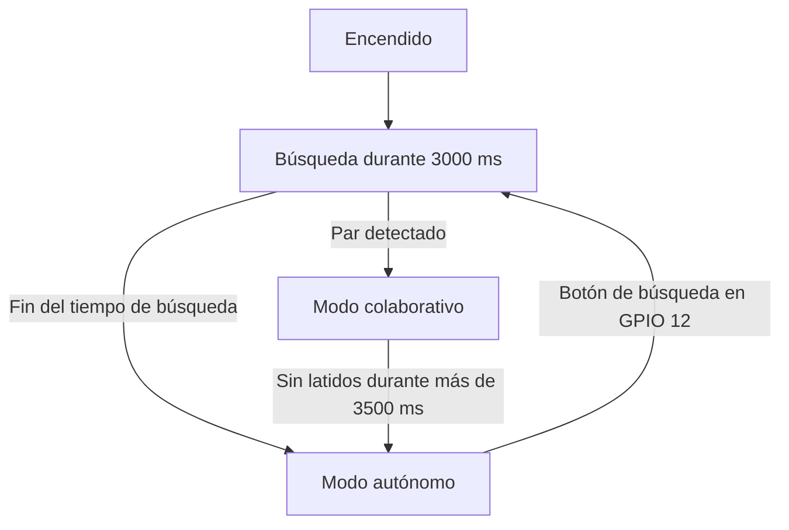

# Sistema de Seguridad Perimetral Distribuido (ESP32)

**Un sistema de seguridad perimetral simétrico y tolerante a fallos, basado en nodos ESP32.**

[Read this in English](README.md)

El diseño utiliza comunicación directa mediante **ESP-NOW** en la capa de enlace de datos, descubrimiento de pares, elección determinista de roles basada en las direcciones MAC de hardware del ESP32 y degradación gradual cuando un par deja de estar disponible. Cada nodo puede funcionar de forma independiente, sin depender de un servidor central.

> **Estado de la implementación:** Este repositorio contiene actualmente un prototipo básico de firmware. El código todavía no implementa todo el diseño descrito a continuación: no incluye elección de líder basada en MAC ni gestión de latidos, el descubrimiento se inicia al pulsar el botón GPIO 12 y el firmware arranca en modo autónomo. Consulta [Firmware actual y diferencias con el diseño](#firmware-actual-y-diferencias-con-el-diseño) antes de construir el sistema completo.

## Características principales

- **Topología simétrica:** Ambos nodos usan el mismo firmware y no necesitan un servidor central.
- **Descubrimiento dinámico:** Los nodos pueden detectar un par después del arranque o de una reconexión.
- **Roles deterministas:** La regla prevista compara las direcciones MAC de hardware; el nodo con la dirección mayor asume el rol de líder.
- **Degradación gradual:**
  - **Modo colaborativo (barrera óptica):** Cuando los nodos están enlazados, el líder emite un haz láser y el seguidor lo supervisa con una fotorresistencia LDR.
  - **Modo autónomo (detección volumétrica):** Si no se encuentra un par o los latidos expiran después de más de 3,5 segundos, el nodo vigila la proximidad con un sensor ultrasónico (distancia menor que 80 cm).
- **Interfaz local:** Una pantalla OLED SSD1306 por I2C muestra el modo operativo, las lecturas de sensores y el estado de alarma.
- **Lectura analógica compatible con la radio:** El diseño indica usar pines ADC1 para los sensores analógicos, evitando el conflicto entre ADC2 y Wi-Fi descrito más abajo.

## Hardware y asignación de pines

| Componente | Señal | GPIO ESP32 | Protocolo / detalles |
|---|---|---:|---|
| Pantalla OLED SSD1306 | SDA | 21 | I2C |
| Pantalla OLED SSD1306 | SCL | 22 | I2C |
| Pantalla OLED SSD1306 | VCC / GND | 3V3 / GND | Lógica de 3,3 V |
| Divisor de tensión de la LDR (10 kΩ) | Señal | 4* | Entrada analógica en el firmware actual |
| Buzzer activo | `+` / `-` | 15 / GND | Salida digital; control directo por nivel lógico |
| Sensor ultrasónico HC-SR04 | TRIG | 19 | Pulso de disparo de 10 µs |
| Sensor ultrasónico HC-SR04 | ECHO | 23 | Medición del ancho del pulso |
| Botón de búsqueda | Señal | 12 | `INPUT_PULLUP`; conectar a GND al pulsar |
| Diodo láser (emisor) | Control | 18 | Salida digital; orientado hacia el nodo par |

**Notas importantes sobre el hardware**

- **GPIO 4 pertenece a ADC2**, no a ADC1. El firmware actual lee la LDR en GPIO 4, lo que entra en conflicto con el objetivo de usar ADC1 mientras Wi-Fi/ESP-NOW está activo. Para cumplirlo, conecta la señal de la LDR a una entrada ADC1 disponible (por ejemplo, GPIO 34) y actualiza `PIN_LDR` en `Sensores.h`. GPIO 34 es solo de entrada.
- La salida `ECHO` del HC-SR04 normalmente es de 5 V. Usa un divisor de tensión o un conversor de nivel para que el GPIO del ESP32 no reciba más de 3,3 V.
- Evita pulsar el botón de búsqueda durante el arranque del ESP32.
- Usa circuitos adecuados de limitación de corriente o controladores para el diodo láser y el buzzer; no alimentes cargas directamente desde un GPIO del ESP32 salvo que sus requisitos eléctricos lo permitan.

## Operación distribuida prevista



1. **Descubrimiento:** Los nodos transmiten tramas `MSG_DESCUBRIMIENTO` por broadcast a `FF:FF:FF:FF:FF:FF` durante tres segundos.
2. **Convergencia y elección de rol:** Después de detectar un par, los nodos comparan sus direcciones MAC:

   `Líder = max(MAC_A, MAC_B)`

3. **Operación colaborativa:** El líder mantiene encendido el láser y envía `MSG_HEARTBEAT` cada 1000 ms. El seguidor supervisa la LDR y reinicia su temporizador de vigilancia.
4. **Gestión de fallos:** Si no llega ningún latido durante más de 3500 ms, el seguidor declara que el líder no está disponible y cambia a la vigilancia ultrasónica autónoma.
5. **Operación autónoma:** Un objeto a menos de 80 cm activa la alarma. El botón de GPIO 12 permite iniciar una nueva búsqueda.

## Dependencias de software

Instala estas bibliotecas desde el Gestor de Bibliotecas de Arduino IDE:

- **Adafruit SSD1306** 2.5.x o superior
- **Adafruit GFX Library** 1.11.x o superior
- **Paquete de placas ESP32 de Espressif Systems** 2.0.x o superior

## Estructura del proyecto

Los archivos que actualmente existen en este repositorio son:

```text
DetectorLaser/
├── DetectorLaser.ino   # Bucle principal, modos operativos y prototipo de descubrimiento ESP-NOW
├── Pantalla.h           # Interfaz de pantalla SSD1306
└── Sensores.h           # LDR, HC-SR04 y buzzer activo
```

El diseño completo también contempla `ClusterManager.h`, `ClusterManager.cpp` y `ClusterProtocol.h` para gestionar el estado del clúster, los latidos, la elección por MAC y las tramas de red empaquetadas. Esos archivos **todavía no están presentes** en este repositorio.

## Firmware actual y diferencias con el diseño

El sketch actual se inicializa en modo autónomo. Al pulsar el botón GPIO 12 comienza una búsqueda de tres segundos; se emiten mensajes de descubrimiento y se registran los pares recibidos. El código actual aún no envía latidos, elige un líder, cambia a modo colaborativo al detectar un par ni aplica el tiempo de espera de 3,5 segundos. El flujo y el comportamiento descritos arriba documentan el diseño previsto; no todas esas funciones están implementadas en el firmware actual.

## Puesta en marcha

1. Conecta los componentes según la tabla de pines y las notas de hardware.
2. Abre `DetectorLaser.ino` en la carpeta `DetectorLaser` con Arduino IDE.
3. Selecciona la placa adecuada, por ejemplo **ESP32 Dev Module**.
4. Instala las dependencias de software indicadas arriba.
5. Sube el firmware al nodo o a los nodos ESP32.
6. Abre el monitor serie a **115200 baudios**.
7. El firmware actual arranca en modo autónomo. Pulsa el botón conectado a GPIO 12 para iniciar el descubrimiento de pares.

El sistema completo previsto debería pasar a modo autónomo si no encuentra un par después de tres segundos, y a modo colaborativo cuando se enlacen dos nodos. Para esas transiciones hace falta la funcionalidad de roles distribuidos y latidos que, como se indicó, aún no está implementada.
