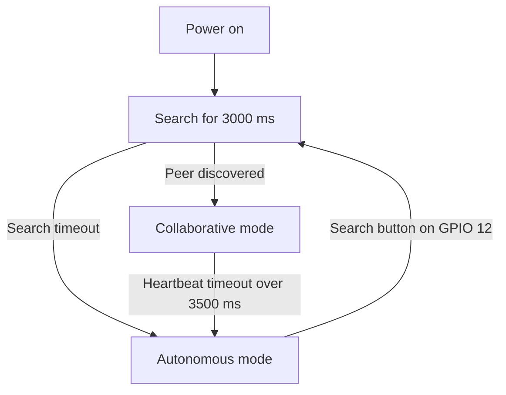

# Distributed Perimeter Security System (ESP32)

**A symmetric, fault-tolerant perimeter security system built with ESP32 nodes.**

[Leer en español](README.es.md)

The design uses direct **ESP-NOW** communication at the data-link layer, peer discovery, deterministic role selection based on the ESP32 hardware MAC addresses, and graceful degradation when a peer is unavailable. Each node can operate independently, so the system does not depend on a central server.

> **Implementation status:** This repository currently contains a basic firmware prototype. Its source does not yet implement the full design described below: there is no MAC-based leader election or heartbeat handling, discovery currently starts when the GPIO 12 button is pressed, and the firmware starts in autonomous mode. See [Current firmware and design gaps](#current-firmware-and-design-gaps) before building a complete system.

## Key Features

- **Symmetric topology:** Both nodes use the same firmware; neither requires a central server.
- **Dynamic discovery:** Nodes can discover a peer after startup or after a reconnection.
- **Deterministic roles:** The intended rule is to compare the two hardware MAC addresses; the node with the higher address becomes the leader.
- **Graceful degradation:**
  - **Collaborative mode (optical barrier):** When paired, the leader emits a laser beam and the follower monitors it with an LDR.
  - **Autonomous mode (volumetric detection):** If no peer is found or heartbeats time out after more than 3.5 seconds, the node monitors proximity with an ultrasonic sensor (distance below 80 cm).
- **Local interface:** An SSD1306 OLED over I2C displays the operating mode, sensor readings, and alarm state.
- **Radio-aware analog sensing:** The design calls for ADC1 pins for analog sensors, avoiding the ESP32 ADC2/Wi-Fi contention described below.

## Hardware and Pinout

| Component | Signal | ESP32 GPIO | Protocol / details |
|---|---|---:|---|
| SSD1306 OLED | SDA | 21 | I2C |
| SSD1306 OLED | SCL | 22 | I2C |
| SSD1306 OLED | VCC / GND | 3V3 / GND | 3.3 V logic |
| LDR voltage divider (10 kΩ) | Signal | 4* | Analog input in the current firmware |
| Active buzzer | `+` / `-` | 15 / GND | Digital output; direct logic-level control |
| HC-SR04 ultrasonic sensor | TRIG | 19 | 10 µs trigger pulse |
| HC-SR04 ultrasonic sensor | ECHO | 23 | Pulse-width measurement |
| Search button | Signal | 12 | `INPUT_PULLUP`; connect to GND when pressed |
| Laser diode (emitter) | Control | 18 | Digital output; points toward the peer node |

**Important hardware notes**

- **GPIO 4 is an ADC2 pin**, not ADC1. The current firmware reads the LDR on GPIO 4, which conflicts with the design goal of using ADC1 while Wi-Fi/ESP-NOW is active. To meet that goal, move the LDR signal to an available ADC1 input (for example, GPIO 34) and update `PIN_LDR` in `Sensores.h`. GPIO 34 is input-only.
- The HC-SR04 `ECHO` output is typically 5 V. Use a voltage divider or level shifter so the ESP32 GPIO receives no more than 3.3 V.
- Avoid pressing the search button during ESP32 startup.
- Provide suitable current limiting/driver circuitry for the laser diode and buzzer; do not power loads directly from an ESP32 GPIO unless their electrical requirements allow it.

## Intended Distributed Operation



1. **Discovery:** Nodes broadcast `MSG_DESCUBRIMIENTO` frames to `FF:FF:FF:FF:FF:FF` for three seconds.
2. **Convergence and role selection:** After discovering a peer, nodes compare their MAC addresses:

   `Leader = max(MAC_A, MAC_B)`

3. **Collaborative operation:** The leader keeps the laser on and sends `MSG_HEARTBEAT` every 1000 ms. The follower monitors the LDR and resets its watchdog timer.
4. **Failure handling:** If no heartbeat arrives for more than 3500 ms, the follower declares the leader unavailable and switches to autonomous ultrasonic monitoring.
5. **Autonomous operation:** An object closer than 80 cm triggers an alarm. A new search can be started with the GPIO 12 button.

## Software Dependencies

Install these libraries using the Arduino IDE Library Manager:

- **Adafruit SSD1306** 2.5.x or later
- **Adafruit GFX Library** 1.11.x or later
- **ESP32 board package by Espressif Systems** 2.0.x or later

## Project Structure

The files currently present in this repository are:

```text
DetectorLaser/
├── DetectorLaser.ino   # Main loop, operating modes, and ESP-NOW discovery prototype
├── Pantalla.h           # SSD1306 display interface
└── Sensores.h           # LDR, HC-SR04, and active buzzer
```

The fuller design also anticipates `ClusterManager.h`, `ClusterManager.cpp`, and `ClusterProtocol.h` for cluster state, heartbeat handling, MAC-based election, and packed network frames. Those files are **not yet present** in this repository.

## Current Firmware and Design Gaps

The current sketch initializes in autonomous mode. Pressing the GPIO 12 button starts a three-second discovery period; discovery messages are broadcast and received peers are recorded. The current code does not yet send heartbeat messages, elect a leader, switch to collaborative mode on peer discovery, or apply the described 3.5-second heartbeat timeout. The design flow and behavior above document the intended system, not features that are all implemented in the current firmware.

## Getting Started

1. Connect the components according to the pinout and hardware notes.
2. Open `DetectorLaser.ino` in the `DetectorLaser` folder with the Arduino IDE.
3. Select the appropriate board, such as **ESP32 Dev Module**.
4. Install the software dependencies listed above.
5. Upload the firmware to the ESP32 node or nodes.
6. Open the Serial Monitor at **115200 baud**.
7. The current firmware starts in autonomous mode. Press the button connected to GPIO 12 to start peer discovery.

The intended completed system should enter autonomous operation if no peer is found after three seconds, and collaborative operation when two nodes pair. Those transitions require the distributed-role and heartbeat functionality noted as not yet implemented above.
